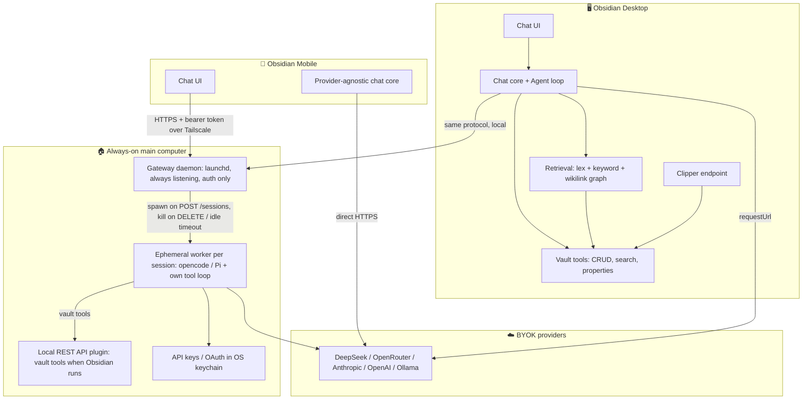

# Obsidian Chat — Plugin Build Plan

> Source: `Inbox/Obsidian Chat.md`
> Date: 2026-09-01 · Status: **Phases 0–2b complete; Phase 3 (harness + mobile) in progress.** Positioning: personal-use-first; public release deferred (Phase 6). All decisions logged in §1.5, §2, §4.

**Goal:** Build an Obsidian plugin that integrates AI chat with BYOK, turning Obsidian into an IDE for research and notetaking.

**Use cases:** research, writing, organizing notes, multi-step knowledge work · notes summary, ideation, finding connecting ideas · a *functioning chat alternative* (replacing Open WebUI / Librechat for vault-grounded topics) · grounded knowledge in the vault.

**Current status (2026-09-03):**
- **Done:** Phases 0 (gates G1–G8), 1 (dual-path grounded chat), 2a (write tools + approval), 2b (search, vision, commands, UI).
- **Phase 3 — plugin-side landed:** BYOK chat works end-to-end (verified with OpenCode; presets for OpenRouter/OpenAI/Anthropic/Groq/Ollama/Mistral/xAI). Provider presets auto-fill base URLs; a model picker lists **all** of a provider's models with pin-to-top. **Research mode** uses a **tool-only grounding policy** — notes enter a turn only via `@mention`, a tool call (`search_vault`/`read_file`), or auto mode. Read tools are always available; write tools are approval-gated (Auto/Review/Plan) with persistent per-tool allow/deny. Blacklist folders + `.chat/rules.md` (nearest-wins). Sessions persist to a configurable vault folder (default `chat/`).
- **Phase 3 — remains:** the **harness** (always-on machine remote agent): harness-side web search, `/jobs` lifecycle + agent worker, plugin job UI, health indicator.
- **Provider/network lesson (implemented):** the direct model path needs a `requestUrl` fallback (CORS), a browser `User-Agent` (Cloudflare WAF), and OpenAI-wrapped tools; providers that block CORS (OpenCode) don't stream — true token streaming comes from the harness/gateway SSE relay.

---

## 1. Step 1 — Establish features to include from inspirations

### 1.1 Feature matrix of the 5 inspiration plugins

| Capability | Copilot (Brevilabs) | Claudian | Karpathy LLM Wiki | Claude Sidebar | AI Agent |
|---|---|---|---|---|---|
| Platforms | Desktop + Mobile | Desktop only | Desktop + Mobile | Desktop only | Desktop only |
| Model access | BYOK + hosted plan + local; keys in OS keychain | Via agent CLIs (Claude Code, Codex, Grok, OpenCode, Pi) | BYOK, 16+ providers, Ollama/LM Studio, Codex OAuth | Via agent CLIs | Gemini/Claude/OpenAI/Ollama |
| Chat UI | Sidebar agent chat + Quick Chat | Sidebar chat, tabs, dual-pane | Query-wiki side panel | Embedded xterm.js terminal | Sidebar chat |
| Agent/harness | opencode (managed), Claude Code, Codex via ACP | Embeds CLIs, MCP via CLI config | None (own pipeline) | PTY terminal running any agent CLI | Own tool-calling loop |
| Vault read tools | ✅ (agent reads vault) | ✅ (agent is in vault) | ✅ (reads notes/PDFs) | ✅ (agent CLI) | ✅ read/list/search/filter |
| Vault write tools | ✅ create notes, edits | ✅ read/write/search/run cmds | ✅ writes only under `wiki/` | ✅ via CLI | ✅ create/edit note, create folder |
| Tags/properties/folders | Partial (files/folders) | Via CLI | Tags/frontmatter on wiki pages | Via CLI | Folders only |
| Grounded retrieval | Miyo semantic index (cloud), semantic search | Agent-native (grep, read) | **PPR over `[[wiki-link]]` graph — no embeddings, no vector DB** | Agent-native | Full-text search |
| Web search | Managed (paid) | Via agent CLI tools | ❌ vault-only by design | Via agent CLI | ✅ built-in tool |
| Vision / images | Partial (agent-dependent) | Via agent CLIs | ✅ PDF/image ingest (MinerU, native PDF) | Via agent CLI | ✅ attach images |
| Web Clipper | ❌ (uses official Obsidian Clipper separately) | ❌ | Composes with official Clipper | ❌ | ❌ |
| Vault rules | Projects (instructions + context) | `/instruction`, skills, Plan Mode | Custom tag vocabulary, task policies | CLI system prompts | ❌ |
| Mobile | ✅ | ❌ | ✅ | ❌ (Claude Anywhere as side project) | ❌ |
| Sessions | Multi-agent tabs, Projects | Tabs, session manager | History panel | Multiple tabs | Chats stored as notes |
| Security model | Keychain, permissions, approval | Approval prompts, MIT | Source files read-only | YOLO mode opt-in | "Review changes" setting |
| License / scorecard | AGPL-3.0 · **Health Excellent / Review Satisfactory** | MIT · **Excellent / Satisfactory** | Apache-2.0 · **Excellent / Passed (Perfect)** | MIT · **Excellent / Satisfactory** | MIT · **Excellent / Passed** |

### 1.2 Scorecard filter (> 3 of 4 on Health **and** Review)

| Plugin | Health | Review | Passes bar (>3/4 both)? |
|---|---|---|---|
| Copilot | Excellent (4) | Satisfactory (3) | ❌ |
| Claudian | Excellent (4) | Satisfactory (3) | ❌ |
| **Karpathy LLM Wiki** | Excellent (4) | Passed / Perfect (4) | ✅ |
| Claude Sidebar | Excellent (4) | Satisfactory (3) | ❌ |
| **AI Agent** | Excellent (4) | Passed (4) | ✅ |

*(Assumes Excellent = 4/4 and Satisfactory = 3/4; verify exact numbers on each plugin's Scorecard tab before finalizing.)*

### 1.3 What we want from each

**Copilot** — take:
- Agent chat with permission-controlled multi-turn tool use
- Projects (persistent instructions + context per research area)
- Quick Ask inline on selection
- BYOK + local + OpenAI-compatible endpoints; keys in OS keychain (never `data.json`)
- Skills reusable across agents, custom `/` commands
- Mobile support as a first-class constraint

**Claudian** — take:
- Provider-agnostic harness architecture (`src/providers/*`, shared `ChatRuntime` contract)
- Inline edit with word-level diff preview
- `@mention` files/subagents, Plan Mode, `/instruction`
- MCP through the harness's native config (don't reimplement MCP)

**Karpathy LLM Wiki** — take (knowledge-layer ideas; **wiki generation itself was later dropped from scope — see §1.5**; the retrieval approach survives and is ours):
- No-chunk / no-embedding retrieval: graph signals over `[[wiki-link]]` structure (Monte Carlo PPR optional — Phase 0 G6 decides)
- 5-stage seed cascade: lex fast path → LLM keywords → local substring scan → semantic fallback → graph expansion
- *(Dropped: entity/concept page generation, `wiki/` output, lint/maintenance)*
- PDF/image/Office ingest paths (native PDF or MinerU) — kept as extraction technique for summarized notes, not wiki pages

**Claude Sidebar** — take:
- Harness-as-terminal concept (proves CLIs can be embedded)
- Multi-tab sessions, per-folder "open here" context
- Right-click context menus (file/folder/selection)

**AI Agent** — take:
- Minimal, complete vault tool set: create/read/edit note, create folder, list files, vault search, date-range filter
- Chats persisted as plain Obsidian notes (survives everything, syncs via Obsidian Sync)
- Web search tool, image attachments
- Review-changes-before-apply toggle

### 1.4 Gap analysis — why none of them is fully usable for our use cases

| Gap | Who has it? | Why it blocks us |
|---|---|---|
| **No plugin has the full package** (wiki grounding + chat + agent + mobile + clipper + harness) | — | Composing 4+ plugins = conflicting UIs, duplicate API config, no shared context |
| Copilot: hosted/cloud features (web search, PDF parse, semantic index) behind paid plan | Copilot | We want BYOK, no subscription |
| Claudian / Claude Sidebar / AI Agent: desktop-only | Claudian, Sidebar, AI Agent | Native mobile interface is a hard requirement |
| Sidebar & Claudian require installing agent CLIs locally on every device | Claudian, Sidebar | Mobile can't run CLIs; we want one harness on the always-on machine |
| Karpathy Wiki: chat is wiki-only, no write tools, no web search, no general chat | Karpathy | Need general chat + full vault CRUD, not just Q&A |
| AI Agent: no grounding strategy beyond text search; no wiki layer | AI Agent | Vault-grounded answers need graph/semantic retrieval at scale |
| Web Clipper: none integrate clipping → AI pipeline | all | Want clip → template → summarize/tag, automated (in-plugin clipper per §2.6) |
| Vault rules: only Copilot Projects and Claudian instructions are close | Copilot, Claudian | Want folder-scoped, hierarchical rules (like Cursor/Claude Code rules) |
| Copilot & Claudian review rating = Satisfactory (3/4) | — | Fails our own quality bar |
| No one treats chats as durable vault artifacts **and** grounded answers **and** agent actions in one coherent model | — | Core differentiator |

**Verdict:** no existing plugin matches. Karpathy Wiki + AI Agent pass the scorecard bar but each covers only one slice. Build our own, borrowing the strongest ideas above.

### 1.5 Feature selection decisions (v1 — confirmed by user, 2026-09-01)

| Area | Decision | Rationale |
|---|---|---|
| Chat core | ✅ ALL: sessions as notes · multi-tab · inline edit w/ diff · slash commands/skills · plan mode · `@mentions` | Directly serve "chat alternative grounded in vault" + "IDE for research"; proven patterns from Copilot/Claudian/AI Agent |
| Wiki layer | ❌ **Omitted from current plan** (user chose b → then excluded). No wiki integration or own wiki engine in scope for now | Simplifies v1; can revisit later — see §4 Q1 |
| Agent runtime | ✅ Both: own tool-calling loop (light chats, mobile-safe) + managed CLI worker on harness (opencode/Pi via ACP — user's stack; Claude Code optional later) | Own loop = BYOK-only, works without the main machine online; harness = full agent power when available (§2.4, §4 Q3/Q4) |
| Vault tools | ✅ ALL: notes read/create/edit · folders · tags · properties · delete→trash · rename/move w/ link update | Doc explicitly requires CRUD of folders/tags/notes/properties; rename+link-update is table stakes for organizing |
| Extras | ✅ ALL: web search (Tavily) · vision · in-plugin clipper (templates + user-defined save dir) · PDF/image ingest · MCP (via harness config) | All map to the original feature list; decisions in §4 Q5 and §2.6 |
| Mobile + harness | ✅ **Decided:** Tailscale + HTTPS bearer token → launchd gateway (always listening) spawning Copilot-style ephemeral workers per session; optional on desktop, direct-BYOK fallback. Full lifecycle in §2.4; mechanism validated in Phase 0 spike first | Keys stay on the always-on machine; phone gets a real agent, not a shrunk chat |

**Consequences of dropping the wiki layer:**
- Retrieval grounding falls back to: lex + keyword + substring over existing `[[wikilinks]]` graph; PPR graph expansion is optional and earns its place in the Phase 0 G6 spike. No generated pages, no lint/maintenance subsystem.
- "PDF/image ingest" no longer feeds wiki pages; it becomes: extract content → summarize/tag into notes on request.
- Karpathy wiki remains a possible future add-on, not a dependency.

**Explicitly NOT in v1:** Wiki layer (dropped above), collab mode (Claudian), hosted models/subscription (violates BYOK principle), multi-agent `@` orchestration (Copilot paid feature), embeddings/vector DB (Karpathy argument holds), i18n beyond English, voice input.

---

## 2. Step 2 — Comprehensive final product brainstorm

### 2.1 Product concept

**"Obsidian Chat" — a vault-native AI workspace.** (wiki layer removed per §1.5 decision)

Two pillars + glue (wiki layer dropped from current plan — see §1.5):

1. **Chat** — a full chat client (sidebar + full-screen + mobile) with BYOK providers, sessions stored as vault notes, `/` commands, skills, `@mention` of notes/tags/folders, inline edit, Plan Mode.
2. **Agent tool layer** — safe vault CRUD (create/delete/edit notes, folders, tags, properties), vault search, web search, vision, PDF/image extraction, clipper pipeline — all with approval modes and folder-scoped rules.

Grounding without a generated wiki: retrieval uses lex + keyword + substring matching over the `[[wikilink]]` graph you already maintain, plus full-text search — no embeddings, no vector DB, no `wiki/` generation step.

Plus the glue: **harness connection** to an always-on main computer so mobile (and desktop) can offload heavy agent work while keys stay on the machine that owns them.

### 2.5 Core workflows (personas)

- **Researcher:** clip 10 articles → "summarize and tag everything in `Inbox/clips/`" → chat: "What do my notes say about X?" with `[[wikilinks]]` citations back into the vault graph.
- **Writer:** select a paragraph → inline edit with diff → draft in a scratch note → "move this into `Projects/book/` with properties `status: drafting`".
- **Knowledge gardener:** weekly agent pass → find orphaned notes, dead links, duplicate topics; propose merges/relinks for approval.
- **Mobile:** capture idea on phone → chat via harness (Tailscale) → "file this under `Inbox/`, add tag `#idea`, link it to `[[Projects/AI]]`."
- **Clipper:** browse an article → clip with the "Research paper" template → lands as Markdown in my chosen `Clippings/` folder; optionally ask the agent to summarize and tag it later.
- **Chat alternative:** anything vault-related goes to Obsidian Chat instead of Open WebUI; one-off questions stay in Open WebUI.

### 2.3 Interface & UX strategy

**One component library, two layouts.** Mobile is not "shrink the desktop sidebar" — it's a first-class design decision made in Phase 1, before any UI exists.

| Surface | Layout | Key affordances |
|---|---|---|
| Desktop | Claudian-style right-docked sidebar; multi-tab or dual-pane session manager | Resizable panes, hover actions, keyboard-first (`Shift+Tab` plan mode, `/`, `@`) |
| Phone | **Full-screen chat workspace** opened as an editor-like main leaf (command + ribbon); slide-over session list instead of tabs | Sticky composer above keyboard with safe-area padding, long-press message actions, diff review as bottom sheet w/ Accept/Reject, 44px touch targets |
| Tablet | Sidebar when wide, full-screen when narrow (auto-switch on pane width) | Both sets as available |

**Why nobody else does this:** Obsidian mobile is a Capacitor webview — no native nav/sheets/gestures, and community plugins can't ship native code. The hard parts are OS-level (SSE streaming while iOS backgrounds the webview, share-sheet entry, keyboard bars, safe areas), so authors either skip mobile (Claudian, Sidebar, AI Agent) or ship ugly-but-working (Copilot). Copilot's ugliness is effort allocation, not impossibility.

**Decided against:** companion PWA served by harness (dropped — user decision), native app (impossible for community plugins anyway).

**Share-sheet capture:** quick captures from any phone app land in `Inbox/` via Obsidian's share extension / "Add to Obsidian"; agent processes them later through the clipper pipeline. Phase 3.

**Differentiator statement:** the first Obsidian AI plugin where the mobile experience is designed, not degraded.

### 2.4 Architecture

**Harness lifecycle (decided 2026-09-01): Copilot-style managed ephemeral workers, relocated to the always-on machine.**

Two layers with different lifetimes:

1. **Gateway — always listening (launchd daemon).** Tiny Node service bound to the Tailscale interface. Holds an open port; authenticates per-device bearer tokens; exposes status; spawns/kills workers. Does no AI work itself → near-zero idle cost. This is what makes remote *initiation* from the phone possible at all.
2. **Worker — ephemeral per conversation.** `POST /sessions` spawns one worker (managed opencode/Pi process + our own tool-calling loop); `DELETE /sessions/:id`, idle timeout (~15 min), or TTL cap kills it. No zombie agents burning tokens or RAM. Long batch jobs run as job-scoped workers that survive client disconnect (poll/reconnect for results).

What each action maps to over Tailscale + HTTPS:

| Action | Mechanism | Lifecycle |
|---|---|---|
| Wake/status check from phone | `GET /health` | Gateway only, instant |
| Start a chat/task | `POST /sessions` → spawn worker | Worker lives for the session |
| Stream tokens + tool events | SSE with auto-reconnect (last-event-id) | Open while streaming; survives phone sleep |
| Remote tool calls | Worker executes them (see below) | Inside worker lifetime |
| End/close | `DELETE /sessions/:id` + idle timeout | Worker killed, gateway stays up |

**Tool execution split (default decided, both paths tested in Phase 0):**
- **(a) Primary — harness-side via Local REST API plugin:** worker calls `https://127.0.0.1:27124/mcp/` (or REST) for vault CRUD — heading/block/frontmatter patching, move-to-trash, link-aware ops, optimistic concurrency (`ifMatch`). MIT, 2.9k stars, solves the hard parts already. Works even when desktop Obsidian is closed (harness edits files directly). Caveat: binds to localhost by default → needs binding/SAN config + Tailscale ACLs; locally generated name-constrained CA.
- **(b) Fallback — plugin-relayed:** when a desktop plugin instance is connected, the harness asks it to perform vault ops through the official Obsidian API (safer, link-aware).

**Why this beats the alternatives (researched):** every inspiration plugin punts on remote lifecycle — Claudian/Claude Sidebar/AI Agent tie agent processes to the Obsidian window on the same machine (desktop-only); Copilot's "Self-Host Mode" is just BYOK routing, not a server; Local REST API is always-on but only alive while Obsidian runs and never designed for phone-initiated agents. Nobody composes gateway + ephemeral workers — that composition *is* the novel part of this plan.

**Design principles**

- **Thin plugin, fat harness.** The plugin never stores API keys for the harness path; keys live on the always-on machine (OS keychain). Mobile talks HTTPS to the gateway with a per-device bearer token (§2.4 lifecycle). Desktop can also run a lightweight direct agent loop for simple chats (works with BYOK too).
- **Provider-neutral core.** One `ChatRuntime` interface; adapters for OpenAI-compatible, Anthropic, Ollama, and harness (ACP worker sessions / HTTP+SSE to gateway). No runtime dependency on a specific vendor.
- **No embeddings / no vector DB.** Retrieval = lex + keyword + substring over the `[[wikilinks]]` graph (PPR expansion optional — see Phase 0 spike). Works on mobile (no heavy local compute), works with local models.
- **Everything durable is a note.** Chats, sessions, clipper inbox — all Markdown, so Obsidian Sync, git, Dataview, Graph View all work for free.
- **User is always in control.** Approval modes (auto / review / off), per-folder permissions, read-only source files, dry-run diffs before apply.

### 2.6 Feature blueprint (mapped to the original list)

| Requirement | Design |
|---|---|
| Karpathy LLM wiki | **Omitted from current plan** (user decision). Revisit later as add-on; retrieval still uses the `[[wikilink]]` graph, no generated pages |
| Native mobile interface | Single codebase, `isMobileApp`-aware; **two-layout UX per §2.3** (desktop sidebar / mobile full-screen workspace); no Node-only APIs (`child_process`, `fs`) in shared paths; `requestUrl` for all network calls |
| Vault rules / understanding | `vault-rules.md` at root + `.chat/rules.md` per folder (hierarchical, nearest wins); rules injected into system prompt; also `AGENTS.md`-style support |
| Web search | **Tavily (user has account)** behind a pluggable `SearchProvider` interface — SearXNG/Brave/Serper swappable later without touching the tool contract; results cited and optionally saved to note |
| Tool calling | Agent loop with typed tools: `read_file`, `search_vault`, `create_note`, `edit_note` (diff), `delete_file` (trash), `rename_move_file` (link update), `create_folder`, `set_property`, `manage_tags`, `web_search`; JSON tool schema; streaming UI with tool-use cards |
| Vision | Image paste/attachment in chat; image files in vault readable by multimodal models; PDF/image → extracted text summarized/tagged into notes on request |
| Web Clipper | **In-plugin clipper that functions like Obsidian Web Clipper:** user-defined templates (variable-based Markdown templates for article / page / selection types) + user-defined save directory. Clipped notes land as plain Markdown in that folder; AI processing (summarize/tag/link) is an optional follow-up via chat/tools, never a requirement to clip. No dependency on the official browser extension or its folders |
| Create/delete/edit folders/tags/notes/properties | Full CRUD tool set with approval modes; properties via `editor`/`metadataCache` APIs; trash instead of hard delete (default); rename/move updates incoming wikilinks |
| Harness connection | **Decided:** Tailscale + HTTPS bearer token to a launchd gateway; ephemeral workers per session (see §2.4 lifecycle). Desktop uses it opportunistically, mobile exclusively; status/health indicator in ribbon. Phase 0 spike validates transport before UI builds on it |

**Additional differentiators to consider:** cost/usage meter per provider, i18n-ready strings, plugin store polish (screenshots, docs, privacy page) — the scorecard bar is real.

### 2.7 Security & privacy

- Keys: OS keychain via `safeStorage` when stored locally; harness holds them otherwise; never in `data.json`, never in logs.
- Network: only to the providers the user configured + the harness the user owns. No telemetry, no backend.
- File ops: approval modes, per-folder allow/deny list, `.chat/` rules, dry-run diffs before apply; deletes go to trash.
- Secrets redaction from prompts/logs; no prompt content in analytics.
- Mobile token: per-device bearer token for the gateway, revocable from the harness at any time; stored via Obsidian's keychain-backed secret storage, never in `data.json`.
- Gateway exposure: bound to the Tailscale interface only (never LAN/WAN), TLS via Tailscale's machine keys + locally generated cert; Tailscale ACLs as a second gate.
- Local REST API caveat: its default binding is `127.0.0.1` — the worker talks to it *on the harness machine only*; it is never exposed to the network itself.

### 2.8 Tech stack decision

| Layer | Choice | Why |
|---|---|---|
| Plugin | TypeScript + esbuild (standard Obsidian template) | Ecosystem standard, fast builds |
| Chat/AI | Custom provider adapters (OpenAI-compatible + Anthropic) or Vercel AI SDK if bundle-friendly | BYOK breadth, local model support |
| Harness | Node/TypeScript gateway (launchd) + ephemeral workers; **ACP (Agent Client Protocol)** as session protocol — opencode/Pi/Claude Code all speak it, so the worker layer stays agent-neutral and new CLIs plug in free | Ecosystem interop for free; custom HTTP only where ACP doesn't fit |
| Vault tools (harness-side) | Local REST API plugin's MCP/REST endpoint on the same machine | Don't rebuild heading patching, trash, link-aware moves — MIT, 2.9k stars |
| Retrieval | In-plugin: lex + keyword + substring over wikilink graph (pure TS, no deps) | No vector DB, mobile-safe |
| PDF/image | Native PDF via providers; MinerU API for the rest (BYOK token) | Proven path from Karpathy Wiki |
| Storage | Vault Markdown + `data.json` for settings only. **Chats: one note per session** in a user-configurable vault folder (default `chat/`) with YAML frontmatter (model, tokens, timestamps, tool-call summary); streaming state in plugin JSON | Durable, syncable |
| License | MIT | Adoption-first; no hosted backend to protect |
| Testing | Jest/Vitest for engine logic; manual vault + BRAT for E2E | Engine is pure functions → highly testable |

---

## 3. Step 3 — Implementation phases (v3, personal-use-first)

> **Positioning (decided 2026-09-01):** this is primarily a *personal* tool. Community-marketplace concerns (submission rules, review polish, public docs) are gated behind a deferred Phase 6 and must not slow Phases 0–5. Distribution until then: symlinked dev install in the vault (or BRAT if we ever share with friends). This also means UI/design investment targets *our* workflows, not App-Store-grade first impressions.

### Pressure-test findings (what changed and why)

| # | Finding | Fix |
|---|---|---|
| 1 | **Timeline was fiction.** Phases summed to 12–18 weeks full-time; this is a side project → real calendar ~6–9 months | Each phase now has a *scope* line sized for part-time; cut-lines named so scope bends, not the schedule |
| 2 | **Phase 0 exit "phone completes one chat turn" conflated spike with product** — no chat UI exists yet | Exit reworded: raw SSE round trip from phone browser → gateway → worker → provider |
| 3 | **Gateway built in Phase 3 but mobile MVP promise needs it earlier.** Direct-BYOK on iOS is fragile (CORS/bundle-size unproven); Tavily direct-call hits CORS from webview anyway | Gateway promoted into Phase 1 as a thin proxy (auth + relay). Workers stay ephemeral per session — Copilot lifecycle preserved, just relocated |
| 4 | **Harness workers need vault tools before Phase 3's write tools exist** — tool contract must be defined once, executed in two places | Tool contract (`read_file`, `search_vault`, … as JSON schema) specified in Phase 1; plugin executes locally, harness worker executes via Local REST API |
| 5 | **Approval UX over remote streaming is the hardest UI problem and sat unexamined** | New Phase 0 spike: approval cards over SSE with reconnect + out-of-band pending state |
| 6 | **No sync-conflict story** despite being a top-3 risk (harness edits while Obsidian open elsewhere) | New Phase 0 spike: LRA PATCH vs Obsidian Sync / iCloud conflict behavior |
| 7 | **Tavily chosen but search provider undecided** — plugin-direct calls hit CORS; harness-side calls don't | Search = harness-side by default (also keeps key off devices); plugin-direct only where CORS allows |
| 8 | **Vault rules missing from grounding chain** — retrieval should respect folder rules from day one | Rules-lite (root `vault-rules.md` + `AGENTS.md` injection) in Phase 1; folder-scoped engine stays Phase 3 |
| 9 | ~~Community submission rules never verified~~ **Moot for now — personal use (v3).** Marketplace compliance deferred to Phase 6; dev-install/BRAT distribution has no review gate. The *technical* unknowns behind old G2 remain real and stay in Phase 0: LRA reachability from worker + CORS behavior of `requestUrl` against Tailscale endpoints | Search = harness-side by default (G7), plugin-direct only where CORS allows; marketplace ruling sought opportunistically, not as a blocker |
| 10 | **Phase 2 overloaded** (write tools + search + vision + commands + plan mode + inline edit ≈ everything risky at once) | Split: 2a write tools / 2b search+vision+commands; each with own exit |
| 11 | **Cost control absent** — DeepSeek makes runaway loops cheap-but-not-free; usage meter was Phase 4 | Loop caps + token budgets in Phase 2a (first time writes can loop); meter moves to Phase 4 as planned |

### Phase 0 — Research & validation (2 weeks, 8 gates)
- **G1 Scorecards:** verify Health/Review numbers hands-on; install AI Agent + Karpathy Wiki in a scratch vault. *(Informational for feature borrowing only — no submission gate applies until Phase 6.)*
- **G2 Technical reachability spike** *(was marketplace compliance — deferred to Phase 6)*: confirm LRA is reachable from a worker on `127.0.0.1` with its PATCH semantics fitting our tool contract, and test `requestUrl` CORS behavior against Tailscale HTTPS endpoints (drives the search-harness-side decision). Marketplace policy reading happens opportunistically in the background, never blocking.
- **G3 Gateway prototype:** launchd daemon + Tailscale bind + bearer tokens + spawn/kill worker + raw SSE echo round trip from phone browser. No chat UI.
- **G4 Approval-over-SSE spike:** pending-approval state survives stream drop and app backgrounding; resolve out-of-band.
- **G5 Concurrency spike:** LRA heading/frontmatter PATCH while desktop Obsidian is open + Obsidian Sync/iCloud active — measure conflicts, pick strategy.
- **G6 Retrieval spike:** lex + keyword + wikilink-graph cascade on a 100-note copy of the real vault; judge answer quality; decide if PPR expansion earns its keep.
- **G7 Provider smoke:** OpenAI-compatible (DeepSeek/OpenRouter) + Anthropic adapters streaming through both plugin-direct and gateway paths; confirm Tavily call works server-side.
- **G8 Mobile constraints:** `requestUrl` limits, Capacitor webview backgrounding behavior, share-sheet entry points documented.
- **Exit:** G3 round trip works; G2/G7 confirm both network paths (plugin-direct vs gateway); G4/G5 have chosen strategies; G6 answers questions acceptably. **Kill/pivot criterion:** if the gateway model proves unworkable technically (transport/auth/lifecycle), fall back to desktop-local agent + vault-sync-as-transport on mobile and re-plan.

### Phase 1 — Dual-path grounded chat (4–5 weeks) · scope: ship something you use daily on desktop *and* phone
- Plugin scaffold, settings (BYOK providers, Tavily key, models), MIT license, repo + CI skeleton.
- **Two-layout UI system from day one (§2.3):** shared component library; desktop sidebar/tabs, mobile full-screen workspace; responsive switch on pane width.
- Streaming chat w/ Markdown, code blocks, clickable wikilinks; SSE reconnect w/ last-event-id.
- Sessions as notes (Q6 format: YAML frontmatter + readable body).
- **Tool contract v1 (read-only):** `read_file`, `search_vault`, `list_folder` as JSON-schema tools — executed locally by the plugin.
- Retrieval cascade from G6 wired into every answer; rules-lite: root `vault-rules.md` + `AGENTS.md` injected into system prompt.
- **Thin gateway v1 (promoted from Phase 3):** auth + relay + ephemeral worker running the same read-only tool set via LRA. Phone uses gateway when home/online, direct-BYOK fallback otherwise.
- Read-only approval mode.
- **Exit:** grounded Q&A with citations on desktop (local) and phone (gateway + fallback paths); one codebase, two designed layouts.

### Phase 2a — Write tools (3–4 weeks) · scope: agent can safely change your vault
- Write tools behind the same contract, both executors: create/edit note (diff preview), rename/move w/ link update, folder create, tags/properties, delete→trash.
- Approval modes done properly: Default/Plan/Auto picker, permission cards w/ persistent allow/deny (Copilot semantics), diff review as bottom sheet on mobile.
- Loop caps + per-session token budget (cost control at the moment looping becomes possible).
- **Exit:** "summarize X into `Inbox/`" and "reorganize these notes" work with reviewable diffs from both desktop and phone.

### Phase 2b — Search, vision, commands (3 weeks) · scope: the chat alternative is complete
- Web search: Tavily via `SearchProvider` interface, harness-side by default (G7), cited results, optional save-to-note.
- Vision: image attachments end-to-end (mobile capture → multimodal provider).
- Slash commands/skills, plan mode, inline edit with word-level diff.
- **Exit:** anything you'd currently take to Open WebUI works better here because it's grounded.

### Phase 3 — Harness power + mobile polish (3–4 weeks) · scope: the always-on machine earns its keep
- Full harness service (repo: `obsidian-chat-harness`) on G3/G4/G5 foundations: ACP worker sessions (opencode/Pi managed binary), job queue w/ job-scoped workers surviving disconnect, health indicator, failover matrix.
- Folder-scoped vault rules engine (`.chat/rules.md`, nearest-wins).
- Share-sheet capture → `Inbox/`; touch polish pass (long-press actions, keyboard accessory bar).
- Desktop connects to gateway optionally (same protocol, local).
- **Exit:** phone starts a 10-minute multi-step research job, locks the phone, finds results waiting.

### Phase 4 — Clipper + ingest + polish (2–3 weeks) · scope: complete the personal tool
- In-plugin web clipper (§2.6): template engine, user-defined templates + save directory; article/page/selection capture; AI summarize/tag as optional follow-up.
- PDF/image extraction → summarized notes.
- Cost/usage meter, cancelable jobs, history panel.
- **Exit:** clip → saved note in my folder, optionally summarized; all original feature-list items working for daily use.

### Phase 5 — Personal hardening (1–2 weeks)
- Security pass *for personal risk model*: secret handling, path traversal, token revocation, redaction of keys from logs. (Accessibility/i18n deferred to Phase 6.)
- Backup/restore story for settings + sessions; day-to-day reliability soak (use it as the primary chat for 2 weeks).
- **Exit:** it's the tool you actually live in; no known data-loss or credential-leak issues.

### Phase 6 — Public release (deferred, when/if wanted)
- Marketplace compliance work deferred from old G2: remote-code ruling on gateway+managed-binary, permissions minimization, disclosure copy, harness packaging decision (standalone vs LRA-style extension **vs Docker image** — see consideration below).
- **Harness packaging — Docker option (consideration, 2026-09-18; prompted by the sibling `obsidian-bookmarks` project adopting a container-first backend).** For a distributable release, ship the harness as a Docker image the plugin attaches to via URL + token, instead of a per-OS launchd/systemd install. This is the model Karakeep and similar self-hosted tools use, and it removes the "hidden per-OS install + always-on Obsidian" burden. Fit is **partial, not clean**, unlike bookmarks:
  - **Containerizes cleanly:** the gateway daemon + `mcp-rules-proxy.mjs` (pure Node, no host-specific deps).
  - **Fights the current design:** ACP workers are *user-installed, separately-credentialed* CLIs (opencode/Pi/Claude Code/Gemini/Goose) spawned as the configured command per Principle III; and keys live in the **OS keychain** (§2.7). Baking a specific agent into the image contradicts harness-agnosticism, and the keychain model has no container equivalent (would need mounted secrets / env injection).
  - **Host reach:** the worker talks to the host's Obsidian Local REST API at `127.0.0.1:27124`; from a container that needs host networking or a bridge, and LRA is only alive while Obsidian runs on that host anyway.
  - **Candidate shapes to evaluate in Phase 6:** (a) container = gateway+proxy only, agents + LRA stay on the host; (b) "batteries-included" image bundling one default agent (e.g. opencode) as a convenience while still allowing an external configured command; (c) keep launchd as the primary personal deployment, offer Docker only as a release-time distribution alternative. No decision now — recorded so the bookmarks precedent is on the table when this phase is picked up.
- Community submission package: manifest, docs site, privacy page, screenshots, GIF demo.
- Accessibility pass, i18n readiness (strings externalized), BRAT beta → feedback loop → 1.0.
- **Exit:** published with Health and Review both >3/4 (your stated bar).

**Milestone order rationale (updated):** grounding before writing (unchanged); gateway moved *before* write tools because mobile is the product's reason to exist and its riskiest path; clipper still last among build phases because it composes with everything; **all public-release concerns gated into deferred Phase 6 per personal-use positioning — Phases 0–5 optimize for "used daily," not marketplace approval.**

---

## 4. Open questions

**All resolved as of 2026-09-01:**

1. ~~Wiki: build or integrate?~~ **Decided (2026-09-01): omitted from current plan.** Revisit as add-on later if the chat+tools product proves it needs generated entity/concept pages.
2. ~~Harness transport/auth mechanism~~ **Decided (2026-09-01): Tailscale + HTTPS bearer token to a launchd gateway** — always-listening listener, ephemeral workers per session (§2.4). Phase 0 spike validates before UI builds on it. LAN WebSocket and Local-REST-API-as-whole-harness rejected as primary; Local REST API retained as the *vault-tool layer inside* the harness.
3. ~~Harness protocol~~ **Decided (2026-09-01): ACP (Agent Client Protocol)** for agent-neutral worker interop (opencode/Pi/Claude Code all speak it); custom HTTP+SSE only between plugin ↔ gateway where ACP doesn't fit (health, auth, job status).
4. ~~Which agent runtime~~ **Decided (2026-09-01): Copilot-style managed ephemeral workers** — opencode/Pi managed binary + our own tool-calling loop, relocated to the always-on machine. Claude Code optional later via same ACP layer.
5. ~~Web search default~~ **Decided (2026-09-01): Tavily** (user has an account), behind a pluggable `SearchProvider` interface so SearXNG (self-hosted on the always-on box) or others can be added later without changing the tool contract.
6. ~~Chat storage format~~ **Decided (2026-09-01): one note per session** — YAML frontmatter (model, tokens, timestamps, tool-call summary) + readable message body; transient streaming state may live in plugin JSON, the transcript is the note.
7. ~~Monetization/license~~ **Decided (2026-09-01): MIT.** BYOK/no-backend means AGPL's cloud-copyleft guards a service we won't run; adoption wins. Revisit only if hosted features ever appear.
8. ~~Local models on mobile~~ **Decided (2026-09-01): out of scope v1.** On-device models are infeasible in community plugins anyway (Capacitor webview, no native code). "Local model" desire is served by the gateway routing to Ollama/LM Studio on the always-on machine.

## 5. Risks

| Risk | Mitigation |
|---|---|
| Wikilink-graph retrieval insufficient without wiki pages | Phase 0 spike; fall back to hybrid BM25+semantic via provider embeddings (BYOK) |
| Mobile plugin API limitations (no `child_process`, CSP) | Enforce mobile-safe architecture from Phase 1; harness owns anything heavy |
| Harness security exposure | Gateway bound to Tailscale interface only (never LAN/WAN), TLS + per-device revocable tokens, Tailscale ACLs as second gate; Local REST API never network-exposed |
| SSE streams drop when iOS backgrounds the webview | last-event-id reconnect designed in from Phase 1; validated in Phase 0 spike |
| Sync conflicts: harness edits files while Obsidian open elsewhere | Prefer plugin-relayed path (b) when a desktop instance is connected; Local REST API `ifMatch` optimistic concurrency otherwise |
| Dependency on Local REST API plugin (single point for vault tools) | Contract tests against its MCP surface; direct-fs fallback kept as option (b') |
| Tool misuse / destructive edits | Approval modes, trash-not-delete, per-folder permissions, dry-run diffs |
| Provider API drift (BYOK breadth) | Provider-neutral adapters, contract tests |
| Scope creep vs 5 plugin ecosystems | Strict phase exits; reuse ecosystems (MCP, ACP, official Clipper) instead of rebuilding |
